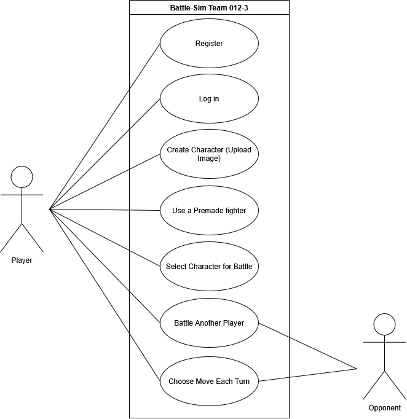

<!---Yuan was a great help on 7,8,9,10,12 and 14, as well as fixing some spelling errors not in those issues, thank you Yuan!  --->
# 1. Team Number
012-3

# 2. Team name
Team Avatar

# 3. Team Members
|Name       | Email      | Github |
| --------- | :---------:|------:|
| Max Martin | Max.Martin-2@colorado.edu | maxwellmartin1005-blip |
| Jamie Grove | Jamie.Grove@colorado.edu | jamiegrove76-pixel |
| Aidan Johnson | Aidan.Johnson-2@colorado.edu | Aidan-dev50 |
| Andre Kalberer | Andre.Kalberer@colorado.edu | AndreKalberer |
| Zander Trafton-Hancock | Zander.Trafton-Hancock@colorado.edu |ZandadaPanda96 |
| Yuan Zuo | Yuan.Zuo@colorado.edu | yuanzuo09 |

# 4. Application Name
Battle Sim 

# 5. Application Description

Battle Sim is an online turn-based multiplayer creature battler where players fight against each other with avatars of themselves or others. While there are many similar games currently on the market, what sets Battle Sim apart is its customisability, as instead of creatures doing the battling, it is a direct representation of the player(or even someone else they may know). By default, there is at least one(probably two for testing) premade fighter for testing and those who don't want to make their own. 

## Character creation
The character creation process is done by uploading an image of the fighter and then going through a process to selct the moves. First the user selects an elmental type either Fire, Water, Earth, Life, Light and Dark. After the type is selcted a move pool is created, (subject for reivew start) these moves are chosen randomly(subject for review end), from a gernal move pool for that type. Please note that every move pool is made up of their elment but may have other elmental moves as well, such as elmentless. (subject for review start) They may even have moves from other elements. (subject for reivew end) (subject for review start) It is important to note that moves that match the elment of the fighter will be stronger than those that do not match(subject for reivew end) The user then selctes four(exact number subject for review, to make the game more unique we may want to avoid four) and they are ready for battle. To use their newly created fighter the player returns to the main menu and opens the battle menu. Once a player enters the battle menu they may select a character, and then select a lobby from all open player lobies(MAX of 2) or create their own(this feautre is subject for review). Once inside the lobby a player may change their charecter, once a player is ready they click the "Mark as Ready" button, once both player have done so the battle beguins. 

## Battle
The game randomly choose which player goes first, and then both players select their moves, the game will wait to continue unitll both player have decied ther moves. Once moves are decided the battle beguins with the turn player's move hitting first, after those moves have finshed the player that was not the turn player becomes the turn player and the cycle repeats until one player's Health Points(HP) are reudced to zero. It should be noted that diffrent elemntal typed moves are weaker or stronger against certian elmental type fighters. Water is weak to Earth and Life moves but stronger against Earth and fire fighters. Life is weak to Fire and Dark moves, but stronger against water and earth fighters, they recive a slight tempory statboost when hit with a Light move, but have a slight tempory statloss when hit with a Dark move(these stat changes are subject to review, may want to be moved to a seperate section for stretch goals). Earth is weak to Water and Life moves but strong against Water fighters. Fire is weak to Water moves but strong against Life fighters. Light is weak to Dark moves, while being stronger against Dark fighters. Dark is weak against life, but strong agaisnt Life and Light Fighters. This elemntal system is bassed on how we see this "elements" act in the real world, like water being able to errode the earth, but dirt can also fill a lake absrobing the watter, which is why they are both weak and strong against eachohter(might be a good stretch goal). (subject for review start)The Turn player's moves do not always hit first, some moves may change this fact for a set amount of turns(subject for reivew ends)

### Notes
Mechanics are subject to change and some are still seeking further review from other team members

# 6. Audience
Our target audience is those looking for a fun game to play together while also looking for a customizable experience. 

# 7. Vision Statement
Our vision statement is: "To create an original and entertaining battle simulator that combines customizable character building with strategic turn-based combat."

# 8. Version Control info
[Github Repository Link](https://github.com/ZandadaPanda96/cu-csci3308-fall2026-group-project-012-3-Battle-Sim)

# 9. Development Methodology
We will use a hybrid Agile Methodology that draws ideas from Scrum and Kanban. 
Particularly, we will have one or multiple short weekly Scrum meetings to discuss about our progress and coordinate work to do for the next sprint.
At the same time, we will track our progress visually in Github issues by opening multiple epics and stories for people to work on and check off.

# 10. Communication Plan
We plan to use Discord as our primary way of communication, and we have already set up a discord server for the project. 
In discord, we will be using the threads feature to keep conversation topics specific and make the chat more organized for future reference.

# 11. Meeting Plan
Team Meeting: Identify the day(s) and time(s), mode, and location your team has agreed upon for regular meetings. “Modality” refers to how you are meeting (face-to-face), group video chat (like Zoom, Google Meet), etc.
Weekly meeting with TA: You will also mention the meeting day, time and location (in-person or online) for the weekly meeting with your TA here.
Please refer to these instructions for expectations in your weekly meeting with your TAs. Do read the entire section carefully.

All times bellow are in MDT unless othweise stated

Team meetings are currently planed to be held in person during recitation hours, which are 11:25 AM- 1:05 PM on Thursdays. If other meetings are required they will be scheduled as the need arises

Weekly meetings with our TA Altaf Barelvi will take place on Tuesday 10:00 AM to 10:15 AM

## Please note
All times listed above are subject to change

# 12. Use Case Diagram

<!----This section is a slightly moddifed from of  Jamie Grove's use_case_diagram.md, thank you again Jamie! ----->

## Actors
- **Player** - A registered user who creates characters and battles.
- **Opponent** - Another player on the other side of the battle.

## Use Cases
| # | Use Case | Description|
|---|----------|------------|
| 1 | Register | A new user creates an account |
| 2 | Log in | A returning user signs in to access their characters |
| 3 | Create Character | The player uploads an image of themselves or someone else to use as their fighter. |
| 4 | Use a premade fighter | The player can pick one of the games fighters instead of making their own. |
| 5 | Select a character for battle | The player chooses which fighter to bring to battle. |
| 6 | Battle another player | Two players battle each other in a turn-based battle. |
| 7 | Choose move each turn | On each turn, the player picks one of their fighters moves to use. |

## Note
Features are subject to change.

# 13. Wireframes
You will create wireframes for each page of the application.
Wireframes are low-fidelity visual representations of the user interface of your application. They are used to plan the layout of the application and to communicate the flow of the application to the team. You can use any tool of your choice to create the wireframes. Hand sketched wireframes are also acceptable. You can refer to this for more information on why and how

import wireframes here

<!----This section is a slightly moddifed from of  Jamie Grove's MilestoneSubmissions/risk_analysis.md, thank you once again Jamie! ----->

# Risk Analysis (Extra Credit)

| # | Risk | Severity | Mitigation | 
|---|------|----------|------------|
| 1 | A team member doesn't finish their part | High | Track tasks on GitHub, check in with the team, and reassign work if someone is stuck. |
| 2 | Merge conflicts when multiple people edit the same file | Medium | Everyone works on their own branch, keeps pull requests small, and pulls from main every time they start working. |
| 3 | Battles are unbalanced or battle logic has bugs | Medium | Keep the battle logic in its own file, test it separately, and adjust move values accordingly. |
| 4 | Changes to the database tables break other teammates' code | Medium | Keep the table setup in one shared SQL file and tell the team before changing it. | 
| 5 | The app runs differently on each teammate's computer | Medium | Everyone runs the app through one shared Docker Compose setup. |
